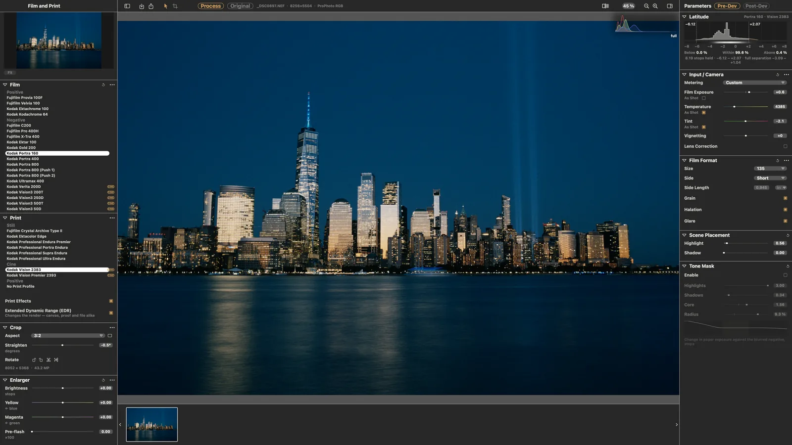
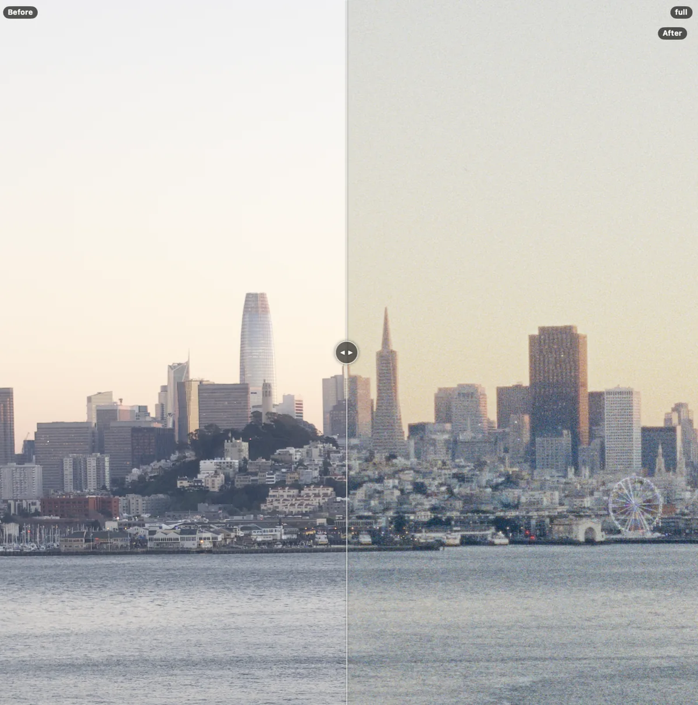

<div align="center">

# SpektraLab for Windows

**Spectral film and print simulation, on Windows.**

A Windows/Vulkan build of [SpektraLab](https://github.com/JamesQiu2005/SpektraLab) — the macOS film-and-print simulator that renders the whole analogue chain instead of a LUT.

[English](README.md) · [简体中文](README.zh-CN.md)

[](https://github.com/Markhhyu/SpektraLab-Windows/releases/latest)
[](https://github.com/Markhhyu/SpektraLab-Windows/actions/workflows/windows-build.yml)
[](https://github.com/Markhhyu/SpektraLab-Windows/actions/workflows/parity.yml)
[](license/LICENSE)



</div>

## What it is

SpektraLab models the photographic process rather than imitating its look:
exposure, film development and printing on real paper stocks, with a spectral
film model and 28 measured film/paper profiles. This repository is the
**Windows build** — the upstream C++20 engine driven by a Vulkan compute
backend, inside a Tauri/React desktop interface.

It began as a port of upstream v1.3.4-beta.3 (tag `9ceca33`) and now has its own
version line. **v1.9.5** calibrates 50D and E100 exposure response, uses RAW
clipping evidence for 800T highlights, and adjusts 50D detail transfer.

> **This is a derivative project, not the upstream.** Issues about the macOS app
> belong to [JamesQiu2005/SpektraLab](https://github.com/JamesQiu2005/SpektraLab);
> issues about this Windows build belong here.

## Download and install

Get `SpektraLab_<version>_x64-setup.exe` from
**[Releases](https://github.com/Markhhyu/SpektraLab-Windows/releases/latest)**
(NSIS, about 38 MB).

| | |
|---|---|
| **OS** | Windows 10 / 11, 64-bit |
| **GPU** | anything with a working Vulkan 1.1+ driver (reference: RTX 4070 Laptop, 8 GB; recent AMD, Intel and NVIDIA cards all work) |
| **WebView2** | the installer downloads the runtime if it is missing |
| **Install** | per-machine, so it needs elevation. The installer is not code-signed: SmartScreen shows “Windows protected your PC” — choose *More info → Run anyway* |

First run: open a RAW (whatever LibRaw supports — see [RAW support](RAW-SUPPORT-20261029.md)),
pick a film stock and a paper, and start adjusting. Film and paper are on the
left, parameters on the right. A 32.95 MP Sony ARW opens in about 1.2 s and the
first live frame arrives in about 0.2 s on the reference machine.

## Features

### Film

- **Per-stock grain** — each VISION3 stock (50D, 250D, 200T, 500T) carries its own
  grain, calibrated to that film's published diffuse-rms granularity (`v1.9.3`).
- **Development** — push/pull from −3 to +3 stops in 1/3 stops, developer
  temperature 18–24 °C. The density curves are fitted to measured push profiles,
  grain coarsens with density, and `Off` is a byte-exact bypass.
- **Scan and viewing light** — choose the illuminant the negative was scanned
  under and the one the print is viewed under; the latter is a CAT02 soft proof
  that also takes over the glare tint.
- **Tone Mask** — each side is calibrated to the reach actually available on the
  chosen paper, and Scene Placement tells you how far you can pull back before
  the frame flattens.
- **28 measured film and paper profiles** with their print LUTs, from
  [spektrafilm](https://github.com/andreavolpato/spektrafilm).



### Performance

- **First frame** — warm-up runs while the RAW decodes: 32.95 MP first live frame
  about 260 ms → 180 ms.
- **Two-stage open** — a half-resolution decode puts a frame on screen in about
  0.45 s instead of 1.12 s; the full decode follows.
- **Export** — one path for preview and export: `tiff16` 2079 → 217 ms, `jpeg`
  1849 → 243 ms at 32.95 MP. TIFF Deflate with predictor makes 16-bit exports
  about 11% smaller, and strip compression is parallel (2.9 s → 0.96 s).
- **Batch export pool** — up to four host processes: three 32.95 MP TIFFs
  18.1 s → 5.8 s (3.1×).

### Workflow

- **Library and collections** — persistent catalog, smart collections, metadata
  editing, non-destructive sidecars, filmstrip hand-off.
- **History and presets** — `Ctrl+H` lists every undo step with a generated label
  and jumps back to it; presets apply as ordinary undoable edits.
- **Local adjustments** — linear and radial masked grades, up to 16 layers,
  applied in linear light after the print.
- **Imaging path** — camera filters (W8/W11/W12/W15/W21/W25/W47/W58), lens blur,
  density-curve gamma, scanner white/black point, scanner lens blur, carrier.

## Build from source

### Requirements

- Windows 10/11 x64 with a Vulkan 1.1+ driver, Vulkan headers and `glslangValidator`
- MinGW-w64 GCC 15 (C++20) and CMake 3.20+; the MSVC build is not validated
- Node.js, a rustup Rust toolchain and NSIS (`makensis`) for the desktop shell and installer

### Engine host

The wrapper downloads and verifies LibRaw, builds the Vulkan host, deploys its
MinGW runtime DLLs and runs CTest:

```powershell
$deps = Join-Path (Split-Path (Get-Location) -Parent) 'deps'
.\engine\setup-libraw.ps1 -DependencyDirectory $deps
.\engine\build-windows.ps1 -LibRawSourceDirectory (Join-Path $deps 'LibRaw-0.22.2')
```

### Desktop app and installer

```bash
cd desktop
npm ci
node scripts/package.mjs windows   # expects build/host-win-x64/ with spektralab-host.exe and engine/
```

The installer lands in `desktop/release/windows/`. Cross-building on macOS and
the MSVC path are covered in
[desktop/docs/WINDOWS-INSTALLER.md](desktop/docs/WINDOWS-INSTALLER.md).

### Tests

```bash
ctest --test-dir build/windows --output-on-failure    # 43 engine/host tests
cd desktop && npx vitest run                          # 531 frontend tests
python engine/tests/parity_upstream.py                # whole-image parity vs the public spektrafilm package
```

The parity and calibration harnesses need a Python venv with `numpy`, `scipy`,
`numba` and `colour-science`; `engine/tests/calibration_sweep.py` checks DIR,
halation and grain monotonicity.

## Documentation

| Document | What it covers |
|---|---|
| [DIFFERENCES.md](DIFFERENCES.md) | Every difference from the macOS app, with the measurements |
| [WINDOWS-PORT.md](WINDOWS-PORT.md) | The port itself: P0/P1 work, parity and regression harnesses |
| [RELEASES.md](RELEASES.md) | Release notes and the release process |
| [ARCHITECTURE.md](ARCHITECTURE.md) | Engine, host and UI architecture |
| [RAW-SUPPORT-20261029.md](RAW-SUPPORT-20261029.md) | RAW formats and camera coverage |

## Known limitations

- The tree is based on upstream v1.3.4-beta.3; macOS-side features added upstream
  since then are not included.
- Paper surface and gloss (the second half of the Lighting work) are not
  implemented — only the illuminant half is.
- Whole-image parity is checked against the public `spektrafilm` package; the
  private macOS reference is unavailable, so the fork-only stocks are covered by
  `parity_product_stocks.py` alone.
- The interface is a Tauri/React port of the macOS layout, not the SwiftUI app;
  some panels differ.
- The installer is unsigned, and there is no auto-updater.

## Feedback and contributions

- Windows build bugs and feature requests: [open an issue](https://github.com/Markhhyu/SpektraLab-Windows/issues).
- macOS app bugs: [JamesQiu2005/SpektraLab](https://github.com/JamesQiu2005/SpektraLab).
- Pull requests are welcome. Run the tests above and keep the repository
  conventions in [AGENTS.md](AGENTS.md) — in particular, a performance claim
  comes with its measurement.

## License and credits

- **Code:** GPL-3.0-or-later — [license/LICENSE](license/LICENSE)
- **Profiles and other data:** CC BY-SA 4.0 — [license/SPEKTRAFILM_LICENSE.txt](license/SPEKTRAFILM_LICENSE.txt)
- Runtime third-party notices: [license/windows-runtime-notices.json](license/windows-runtime-notices.json)

| | |
|---|---|
| **SpektraLab** | [JamesQiu2005/SpektraLab](https://github.com/JamesQiu2005/SpektraLab) — the upstream macOS app, snapshot tag `9ceca33` |
| **spektrafilm** | [andreavolpato/spektrafilm](https://github.com/andreavolpato/spektrafilm) — film process model, profiles and print LUTs, by Andrea Volpato |
| **B&W profiles** | by Hanze Qiu |
