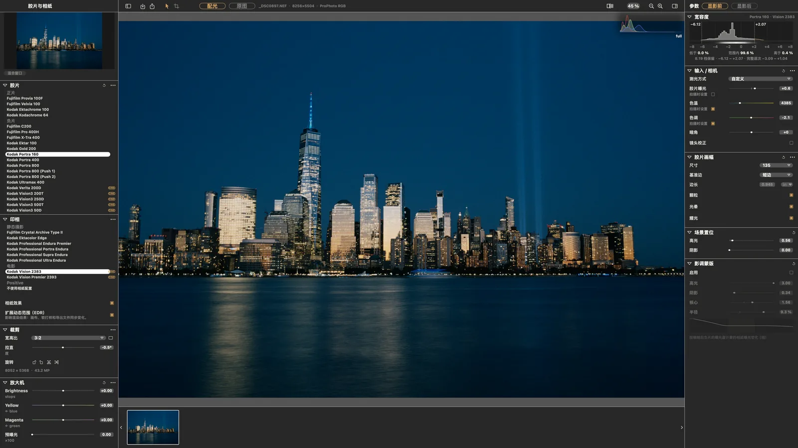
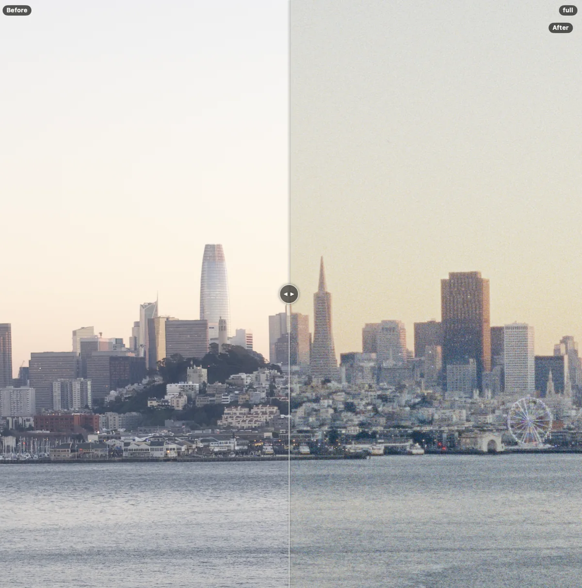

<div align="center">

# SpektraLab for Windows

**电影胶片与相纸模拟，跑在 Windows 上。**

[SpektraLab](https://github.com/JamesQiu2005/SpektraLab) 的 Windows/Vulkan 构建 —— 不套滤镜，而是把整条摄影流程算出来。

[English](README.md) · **简体中文**

[](https://github.com/Markhhyu/SpektraLab-Windows/releases/latest)
[](https://github.com/Markhhyu/SpektraLab-Windows/actions/workflows/windows-build.yml)
[](https://github.com/Markhhyu/SpektraLab-Windows/actions/workflows/parity.yml)
[](license/LICENSE)



</div>

## 这是什么

SpektraLab 不模仿"胶片感"，它模拟整条流程：曝光、显影、在真实相纸上打印，
用光谱胶片模型和 28 个实测胶片／相纸 profile 算出来。这个仓库是它的
**Windows 版** —— 沿用上游的 C++20 引擎，渲染换成 Vulkan 计算后端，界面是
Tauri/React 桌面应用。

起点是上游 **v1.3.4-beta.3**（tag `9ceca33`），之后走自己的版本线。
**v1.9.5** 校准了 50D 和 E100 的曝光响应，用 RAW 饱和信息判断 800T 高光，
并按原厂曲线调整了 50D 对细节的还原。

> **这是衍生项目，不是上游。** macOS 应用的问题请提给
> [JamesQiu2005/SpektraLab](https://github.com/JamesQiu2005/SpektraLab)；
> 这个 Windows 版的问题提到本仓库。

## 下载与安装

在 **[Releases](https://github.com/Markhhyu/SpektraLab-Windows/releases/latest)**
下载 `SpektraLab_<版本>_x64-setup.exe`（NSIS 安装包，约 38 MB）。

| | |
|---|---|
| **系统** | Windows 10 / 11，64 位 |
| **显卡** | 能跑 Vulkan 1.1+ 的驱动即可（参考机 RTX 4070 Laptop / 8 GB；近年的 AMD、Intel、NVIDIA 都可以） |
| **WebView2** | 系统没有时安装包会自动下载 |
| **安装** | 默认按"所有用户"安装，需要管理员权限。安装包没有代码签名，SmartScreen 会提示“Windows 已保护你的电脑”，点 *更多信息 → 仍要运行* 即可 |

第一次打开：载入一张 RAW（LibRaw 支持的格式，见 [RAW 支持](RAW-SUPPORT-20261029.md)），
挑一个片种和一种相纸，然后开始调。胶片和相纸在左边，参数在右边。参考机上
一张 32.95 MP 的索尼 ARW 约 1.2 秒打开，第一帧实时预览约 0.2 秒出来。

## 功能

### 胶片

- **按片种标定的颗粒** —— VISION3 的 50D、250D、200T、500T 各自用自家 datasheet
  的 diffuse rms 颗粒度标定，不再共用一组参数（`v1.9.3`）。
- **显影** —— 推拉从 −3 到 +3 档、每档 1/3 步进，显影温度 18–24 °C。密度曲线
  按实测推拉曲线拟合，颗粒随密度变粗，`Off` 是逐字节直通。
- **扫描光和观看光** —— 可以分别指定底片扫描时的光源和照片观看时的光源，后者
  是 CAT02 软打样，同时接管眩光偏色。
- **Tone Mask** —— 高光、暗部两侧按所选相纸实际能覆盖的范围标定；Scene
  Placement 会告诉你还能往回拉多少，再拉画面就平了。
- **28 个实测胶片与相纸 profile** 及其打印 LUT，来自
  [spektrafilm](https://github.com/andreavolpato/spektrafilm)。



### 性能

- **首帧** —— 解码 RAW 的同时做预热：32.95 MP 的第一帧实时预览从约 260 ms 降到 180 ms。
- **两段式打开** —— 先用半分辨率解码，约 0.45 秒（原来 1.12 秒）出画面，再解码全尺寸。
- **导出** —— 预览和导出走同一条链路：32.95 MP 下 `tiff16` 从 2079 ms 降到 217 ms，
  `jpeg` 从 1849 ms 降到 243 ms。TIFF Deflate 加 predictor 让 16 位导出小约 11%，
  条带压缩并行化，2.9 秒降到 0.96 秒。
- **批量导出池** —— 最多四个 host 进程：三张 32.95 MP TIFF 从 18.1 秒降到 5.8 秒（3.1×）。

### 工作流

- **图库与收藏夹** —— 持久化目录、智能收藏夹、元数据编辑、非破坏性 sidecar、
  缩略图条接力打开。
- **历史与预设** —— `Ctrl+H` 列出每一步撤销（带自动生成的说明）并可以跳回去；
  预设也作为普通的可撤销编辑生效。
- **局部调整** —— 线性与径向蒙版调整，最多 16 层，在打印之后按线性光应用。
- **成像链路** —— 相机滤镜（W8/W11/W12/W15/W21/W25/W47/W58）、镜头模糊、密度曲线
  gamma、扫描仪白／黑点、扫描仪镜头模糊、片夹（none/black/open）。

## 从源码构建

### 环境要求

- Windows 10/11 x64，显卡驱动支持 Vulkan 1.1+，装好 Vulkan headers 和 `glslangValidator`
- MinGW-w64 GCC 15（C++20）和 CMake 3.20+；MSVC 构建没有经过同样验证
- Node.js、rustup 安装的 Rust 工具链，以及 NSIS（`makensis`），用于桌面壳和安装包

### 引擎 host

仓库自带的包装脚本会下载并校验 LibRaw、构建 Vulkan host、部署 MinGW 运行时 DLL
并跑 CTest：

```powershell
$deps = Join-Path (Split-Path (Get-Location) -Parent) 'deps'
.\engine\setup-libraw.ps1 -DependencyDirectory $deps
.\engine\build-windows.ps1 -LibRawSourceDirectory (Join-Path $deps 'LibRaw-0.22.2')
```

### 桌面应用与安装包

```bash
cd desktop
npm ci
node scripts/package.mjs windows   # 需要 build/host-win-x64/ 里有 spektralab-host.exe 和 engine/
```

安装包输出到 `desktop/release/windows/`。在 macOS 上交叉构建、以及 MSVC 路径，
见 [desktop/docs/WINDOWS-INSTALLER.md](desktop/docs/WINDOWS-INSTALLER.md)。

### 测试

```bash
ctest --test-dir build/windows --output-on-failure    # 43 个引擎／host 测试
cd desktop && npx vitest run                          # 531 个前端测试
python engine/tests/parity_upstream.py                # 对齐公开 spektrafilm 包的全图一致性
```

一致性和标定脚本需要带 `numpy`、`scipy`、`numba`、`colour-science` 的 Python 虚拟环境；
`engine/tests/calibration_sweep.py` 检查 DIR、halation、颗粒的单调性。

## 文档

| 文档 | 内容 |
|---|---|
| [DIFFERENCES.md](DIFFERENCES.md) | 与 macOS 版的全部差异，附测量数据 |
| [WINDOWS-PORT.md](WINDOWS-PORT.md) | 移植本身：P0/P1 工作、一致性与回归测试 |
| [RELEASES.md](RELEASES.md) | 版本历史与发布流程 |
| [ARCHITECTURE.md](ARCHITECTURE.md) | 引擎、host 和界面的架构 |
| [RAW-SUPPORT-20261029.md](RAW-SUPPORT-20261029.md) | 支持的 RAW 格式与相机 |

## 已知限制

- 基于上游 v1.3.4-beta.3，上游之后只在 macOS 侧加的功能这里没有。
- 相纸表面与光泽（Lighting 的后半部分）没有实现，只做了光源那一半。
- 全图一致性是对公开的 `spektrafilm` 包验证的；私有 macOS 参考拿不到，所以
  本仓库独有的片种只能靠 `parity_product_stocks.py` 覆盖。
- 界面是 macOS 布局的 Tauri/React 移植，不是 SwiftUI，个别面板有差异。
- 安装包没有签名，也没有自动更新。

## 反馈与贡献

- Windows 版的 bug 和需求：[提 issue](https://github.com/Markhhyu/SpektraLab-Windows/issues)。
- macOS 应用的问题：[JamesQiu2005/SpektraLab](https://github.com/JamesQiu2005/SpektraLab)。
- 欢迎 PR。提交前请跑上面的测试，并遵守仓库约定（[AGENTS.md](AGENTS.md)）——
  尤其是：任何性能结论都要附上测量数据。

## 许可与致谢

- **代码**：GPL-3.0-or-later —— [license/LICENSE](license/LICENSE)
- **profile 和其他数据**：CC BY-SA 4.0 —— [license/SPEKTRAFILM_LICENSE.txt](license/SPEKTRAFILM_LICENSE.txt)
- 运行时第三方声明：[license/windows-runtime-notices.json](license/windows-runtime-notices.json)

| | |
|---|---|
| **SpektraLab** | [JamesQiu2005/SpektraLab](https://github.com/JamesQiu2005/SpektraLab) —— 上游 macOS 应用，快照 tag `9ceca33` |
| **spektrafilm** | [andreavolpato/spektrafilm](https://github.com/andreavolpato/spektrafilm) —— 胶片过程模型、profile 与打印 LUT，作者 Andrea Volpato |
| **黑白 profile** | 由 Hanze Qiu 制作 |
